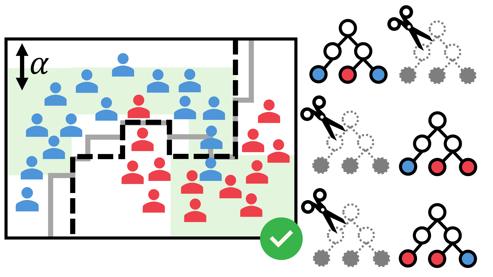

I am **Haruki Yajima**, a first-year master's student at The University of Tokyo.
I am enrolled in the Department of Information and Communication Engineering at the Graduate School of Information Science and Technology.

My research interests lie in **AI safety** and **trustworthy AI**. I currently work as a research assistant with Prof. [Isao Echizen](https://research.nii.ac.jp/~iechizen/official/index-e.html) on AI safety. As an undergraduate, I worked with Prof. [Yusuke Matsui](https://yusukematsui.me/index.html) on reliable pruning methods for machine learning models. This work was accepted to ICML 2026 (CORE: A\*).

# 🔥 News
{: #news}

- *2026.05.01* My first-author paper has been accepted to ICML 2026!
- *2026.03.23* I have joined the Supercell AI Innovation Lab!

# 📝 Publications
{: #publications}

  

    

      
ICML 2026

      
    

  

  

[PINE: Pruning Boosted Tree Ensembles with Conformal In-Distribution Prediction Equivalence](https://arxiv.org/abs/2605.28068)

**Haruki Yajima**, Yusuke Matsui

[International Conference on Machine Learning](https://icml.cc/), 2026. Poster Presentation (26.6% acceptance rate).

[**Project Page**](https://haruk1y.github.io/pine-icml/) · [**Paper**](https://arxiv.org/abs/2605.28068) · [**Code**](https://github.com/Haruk1y/pine)

  

- **PINE: 分布内領域での予測一致を保証する決定木アンサンブルプルーニング** 
  **矢島陽樹**, 松井勇佑 
  画像の認識・理解シンポジウム / Meeting on Image Recognition and Understanding (MIRU), 2026. Oral Presentation (33.5% oral presentation rate). [Awards](#honors-and-awards)

# 🎖 Honors and Awards
{: #honors-and-awards}


- *{{ award.date | date: "%Y.%m.%d" }}* [{{ award.title | replace: "|", "&#124;" }}]({{ award.url }}). {{ award.awarder }}. {{ award.summary }}


# 📖 Educations
{: #educations}


- **, **{{ school.studyType }}**, [{{ school.institution }}]({{ school.url }}), {{ school.location }}.
   {{ school.area }}.


# 💻 Experience
{: #experience}


- **, **[{{ job.name }}]({{ job.url }}){{ job.name }}**, {{ job.position }}.
  
  - {{ detail }}
  
  
  - {{ job.summary }} ([{{ link.name }}]({{ link.url }}))
  


# Projects
{: #projects}


- **, **[{{ project.name | replace: "|", "&#124;" }}]({{ project.url }})**.
  
  - {{ detail }}
  
  - {{ project.summary }}
  - [{{ link.name }}]({{ link.url }}) · 


# Skills
{: #skills}


- **{{ skill.name }}** · {{ skill.keywords | join: ", " }}

